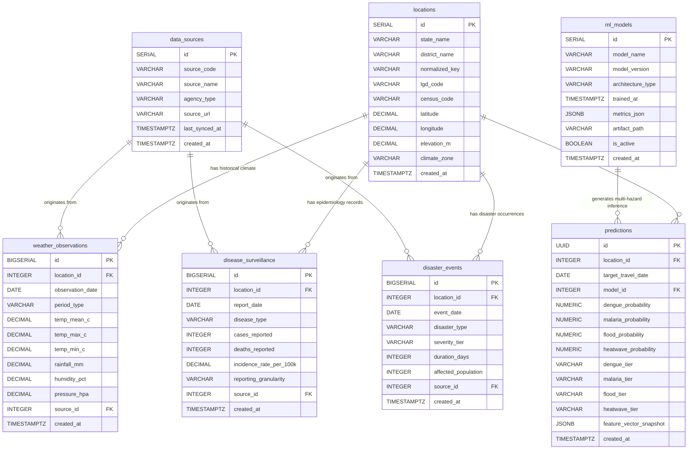

# BHARAT-TRAVELSHIELD AI — ENTITY RELATIONSHIP (ER) SPECIFICATION

**Author:** Pranav (Role: Database + Integration + Documentation)  
**Project:** Bharat-TravelShield AI  
**Repository:** [Varesh2005/Bharat_TravelShield_AI](https://github.com/Varesh2005/Bharat_TravelShield_AI)  
**Document Status:** `PROPOSED ARCHITECTURAL BASELINE`  
**Phase:** Phase 1 — Database Architecture & Integration Contracts  
**Last Updated:** September 13, 2026  

---

## 1. MERMAID ENTITY RELATIONSHIP DIAGRAM

---

## 2. CARDINALITY & RELATIONSHIP EXPLANATIONS

### 1. `locations` to `weather_observations` (One-to-Many: `1 : N`)
- **Cardinality:** `locations (1) ----< (N) weather_observations`
- **Semantics:** A single administrative location (district) has multiple historical weather records across different calendar days, months, or years.
- **Foreign Key:** `weather_observations.location_id REFERENCES locations(id) ON DELETE RESTRICT`.
- **Constraint:** A district cannot be deleted if historical weather observations exist.

### 2. `locations` to `disease_surveillance` (One-to-Many: `1 : N`)
- **Cardinality:** `locations (1) ----< (N) disease_surveillance`
- **Semantics:** A single district has multiple surveillance records, segmented by reporting date and disease hazard (`'DENGUE'` or `'MALARIA'`).
- **Foreign Key:** `disease_surveillance.location_id REFERENCES locations(id) ON DELETE RESTRICT`.

### 3. `locations` to `disaster_events` (One-to-Many: `1 : N`)
- **Cardinality:** `locations (1) ----< (N) disaster_events`
- **Semantics:** A single district has zero or more recorded historical disaster events (`'FLOOD'` or `'HEATWAVE'`).
- **Foreign Key:** `disaster_events.location_id REFERENCES locations(id) ON DELETE RESTRICT`.

### 4. `locations` to `predictions` (One-to-Many: `1 : N`)
- **Cardinality:** `locations (1) ----< (N) predictions`
- **Semantics:** A single district receives multiple prediction queries over time from travelers requesting travel risk intelligence for various future travel dates.
- **Foreign Key:** `predictions.location_id REFERENCES locations(id) ON DELETE RESTRICT`.

### 5. `data_sources` to Observational Tables (One-to-Many: `1 : N`)
- **Cardinality:**
  - `data_sources (1) ----< (N) weather_observations`
  - `data_sources (1) ----< (N) disease_surveillance`
  - `data_sources (1) ----< (N) disaster_events`
- **Semantics:** Each observational record is attributed to exactly one official originating data agency (e.g. IMD, NVBDCP, NDMA).
- **Foreign Key:** `*.source_id REFERENCES data_sources(id) ON DELETE RESTRICT`.

### 6. `ml_models` to `predictions` (One-to-Many: `1 : N`)
- **Cardinality:** `ml_models (1) ----< (N) predictions`
- **Semantics:** A single deployed model (e.g., `'ann_mlp_v1.0'`) generates many predictions over its active lifecycle. Every logged prediction points deterministically to the model version that generated its risk probabilities.
- **Foreign Key:** `predictions.model_id REFERENCES ml_models(id) ON DELETE RESTRICT`.

---

## 3. INTEGRITY & CONSTRAINT SPECIFICATIONS

| Source Table | Constraint Name | Type | Target / Expression | Status |
| :--- | :--- | :--- | :--- | :--- |
| `locations` | `uq_location_state_district` | Unique | `UNIQUE(state_name, district_name)` | `CONFIRMED` |
| `locations` | `uq_location_normalized_key` | Unique | `UNIQUE(normalized_key)` | `PROPOSED` |
| `locations` | `chk_lat_bounds` | Check | `latitude BETWEEN 6.0 AND 38.0` | `CONFIRMED` |
| `locations` | `chk_lon_bounds` | Check | `longitude BETWEEN 68.0 AND 98.0` | `CONFIRMED` |
| `weather_observations` | `uq_weather_loc_date` | Unique | `UNIQUE(location_id, observation_date)` | `PROPOSED` |
| `weather_observations` | `chk_rainfall_positive` | Check | `rainfall_mm >= 0.0` | `CONFIRMED` |
| `weather_observations` | `chk_humidity_range` | Check | `humidity_pct BETWEEN 0.0 AND 100.0` | `CONFIRMED` |
| `disease_surveillance` | `chk_disease_type` | Check | `disease_type IN ('DENGUE', 'MALARIA')` | `CONFIRMED` |
| `disaster_events` | `chk_disaster_type` | Check | `disaster_type IN ('FLOOD', 'HEATWAVE')` | `CONFIRMED` |
| `ml_models` | `uq_model_name_version` | Unique | `UNIQUE(model_name, model_version)` | `CONFIRMED` |
| `predictions` | `chk_dengue_prob` | Check | `dengue_probability BETWEEN 0.0 AND 1.0` | `CONFIRMED` |
| `predictions` | `chk_malaria_prob` | Check | `malaria_probability BETWEEN 0.0 AND 1.0` | `CONFIRMED` |
| `predictions` | `chk_flood_prob` | Check | `flood_probability BETWEEN 0.0 AND 1.0` | `CONFIRMED` |
| `predictions` | `chk_heatwave_prob` | Check | `heatwave_probability BETWEEN 0.0 AND 1.0` | `CONFIRMED` |
| `predictions` | `chk_dengue_tier` | Check | `dengue_tier IN ('Low', 'Moderate', 'Elevated', 'High', 'Severe')` | `PROPOSED` |
| `predictions` | `chk_malaria_tier` | Check | `malaria_tier IN ('Low', 'Moderate', 'Elevated', 'High', 'Severe')` | `PROPOSED` |
| `predictions` | `chk_flood_tier` | Check | `flood_tier IN ('Low', 'Moderate', 'Elevated', 'High', 'Severe')` | `PROPOSED` |
| `predictions` | `chk_heatwave_tier` | Check | `heatwave_tier IN ('Low', 'Moderate', 'Elevated', 'High', 'Severe')` | `PROPOSED` |
